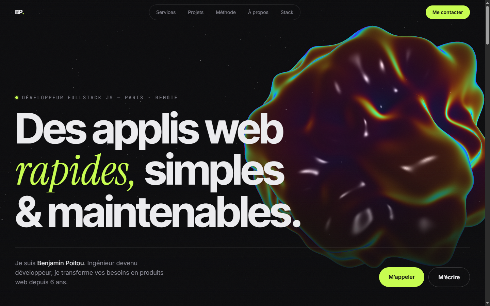

# Benjamin Poitou — Portfolio

[](https://github.com/poitouBenjamin/portfolio-v2/actions/workflows/ci.yml)

Site vitrine de **Benjamin Poitou**, développeur fullstack JS freelance (Paris · remote).

**En ligne : [poitou.digital](https://poitou.digital)** · [version anglaise](https://poitou.digital/en)



## Stack

| Domaine   | Choix                                                                |
| --------- | -------------------------------------------------------------------- |
| Framework | [Next.js 16](https://nextjs.org) (App Router), React 19, TypeScript  |
| Style     | Tailwind CSS 4, polices auto-hébergées via `next/font`               |
| 3D        | [Three.js](https://threejs.org) et shaders GLSL écrits à la main     |
| Animation | [GSAP](https://gsap.com) + ScrollTrigger, [Lenis](https://lenis.dev) |
| i18n      | [next-intl](https://next-intl.dev), français et anglais, clés typées |
| Qualité   | ESLint 9, Prettier, `tsc --noEmit`                                   |

## Points notables

- **Hero WebGL.** Une icosphère est déformée par deux octaves de bruit simplex dans le vertex shader, et les normales sont recalculées par différences finies. Le fragment shader combine un effet de Fresnel irisé et une lumière qui suit la souris.
- **Performance.** La page est un Server Component pré-rendu en statique. Three.js est importé dynamiquement, hors du bundle initial. Le rendu se met en pause quand le canvas sort de l'écran, et le `devicePixelRatio` est plafonné à 2.
- **Accessibilité.** `prefers-reduced-motion` coupe les animations et le défilement fluide. Le carrousel suit la sémantique `tablist`/`tabpanel` et se pilote au clavier. Le curseur et l'effet magnétique ne s'activent qu'avec une souris (`pointer: fine`).
- **Robustesse.** Chaque effet renvoie une fonction de nettoyage (listeners, contexte GSAP, ressources GPU), pour un fonctionnement correct en StrictMode.
- **Bilingue.** Le français est servi sur `/` et l'anglais sur `/en`, tous deux pré-rendus en statique. Les textes vivent dans [`messages/`](messages), et les clés sont typées à partir de `fr.json` : une clé manquante ou mal orthographiée casse la compilation. La détection automatique de langue est désactivée, pour qu'un navigateur anglophone puisse toujours revenir au français.
- **Brief projet.** `/brief` propose un questionnaire en 5 étapes pour cadrer le besoin client : contexte, existant, fonctionnalités, budget et délais. Un même schéma zod ([`lib/brief.ts`](lib/brief.ts)) valide chaque étape côté client et toute la requête côté serveur. La route [`app/api/brief`](app/api/brief/route.ts) envoie un email via Resend, avec `Reply-To` sur le client. Anti-spam : champ piège invisible et délai minimum de remplissage. Le brouillon est conservé en `sessionStorage`.
- **Contenu centralisé.** Les données indépendantes de la langue (liens, stack, logos) sont dans [`lib/site.ts`](lib/site.ts).

## Structure

```
app/
  [locale]/
    layout.tsx        polices, métadonnées localisées, montage des interactions
    page.tsx          sections de la landing (Server Component)
    brief/page.tsx    page du brief projet
  api/brief/route.ts  validation et envoi du brief par email
  globals.css         tokens du thème et effets (grain, halo, bandeau)
components/
  HeroScene.tsx       montage paresseux de la scène 3D
  Interactions.tsx    défilement fluide, apparitions, curseur
  SkillsCarousel.tsx  carrousel de compétences accessible
  BriefForm.tsx       formulaire de brief en plusieurs étapes
i18n/
  routing.ts          langues, langue par défaut, préfixes d'URL
  request.ts          chargement des messages par requête
messages/
  fr.json, en.json    traductions
lib/
  site.ts             données indépendantes de la langue
  brief.ts            étapes, options et schéma zod du brief
  hero-scene.ts       scène Three.js et shaders
  interactions.ts     GSAP, ScrollTrigger, Lenis
proxy.ts              routage par langue (next-intl)
```

## Démarrer

Prérequis : Node.js 20 ou plus (voir `.nvmrc`).

```bash
npm install
npm run dev        # http://localhost:3000
```

| Script                 | Rôle                             |
| ---------------------- | -------------------------------- |
| `npm run build`        | build de production              |
| `npm run lint`         | ESLint                           |
| `npm run typecheck`    | vérification TypeScript          |
| `npm run format`       | formatage Prettier               |
| `npm run format:check` | vérifie le formatage sans écrire |

## Variables d'environnement

Copier `.env.example` en `.env.local`, puis renseigner :

| Variable                                                   | Rôle                                                                               |
| ---------------------------------------------------------- | ---------------------------------------------------------------------------------- |
| `RESEND_API_KEY`                                           | clé API [Resend](https://resend.com) pour l'envoi du brief                         |
| `BRIEF_TO`                                                 | destinataire (optionnel, par défaut l'email de `lib/site.ts`)                      |
| `BRIEF_FROM`                                               | expéditeur (optionnel, il faut un domaine vérifié chez Resend pour le changer)     |
| `UPSTASH_REDIS_REST_URL` / `_TOKEN`                        | stockage des pistes de l’Aperçu IA et limite anti-abus (obligatoire en production) |
| `STRIPE_SECRET_KEY` / `NEXT_PUBLIC_STRIPE_PUBLISHABLE_KEY` | paiement du déblocage des pistes 2 et 3                                            |

Sans clé, en développement, le brief est affiché dans la console du serveur. En production, l'API répond 503.

Esquisses : à l'envoi du brief, trois directions de page d'accueil sont générées en arrière-plan ([`lib/esquisses`](lib/esquisses)), avec leurs vignettes capturées dans un Chrome sans interface. Benjamin reçoit un email de relecture avec un lien signé, puis envoie au client l'email « Trois directions pour … » : la première esquisse nette, les deux autres floutées, qui mènent à `/esquisses/[id]`. Les esquisses 2 et 3 s'y débloquent pour 49 € via Stripe Checkout intégré à la page. Les esquisses restent côté serveur : le navigateur ne reçoit qu'une version floutée au texte brouillé tant que le paiement n'est pas vérifié auprès de Stripe.

## Déploiement

Hébergé sur [Vercel](https://vercel.com), relié à ce repo : chaque merge sur `main` déploie la production, et chaque Pull Request reçoit sa propre URL de prévisualisation (review app). Les variables d'environnement de production (`RESEND_API_KEY`, `BRIEF_TO`, `BRIEF_FROM`) sont définies dans les réglages du projet Vercel, jamais dans le repo.

## Workflow

Une branche par changement (`feat/`, `fix/`, `chore/`, `ci/`, `docs/`), des commits au format [Conventional Commits](https://www.conventionalcommits.org), et un merge sur `main` par Pull Request.

## Contact

[poitou.benjamin.dev@gmail.com](mailto:poitou.benjamin.dev@gmail.com)
